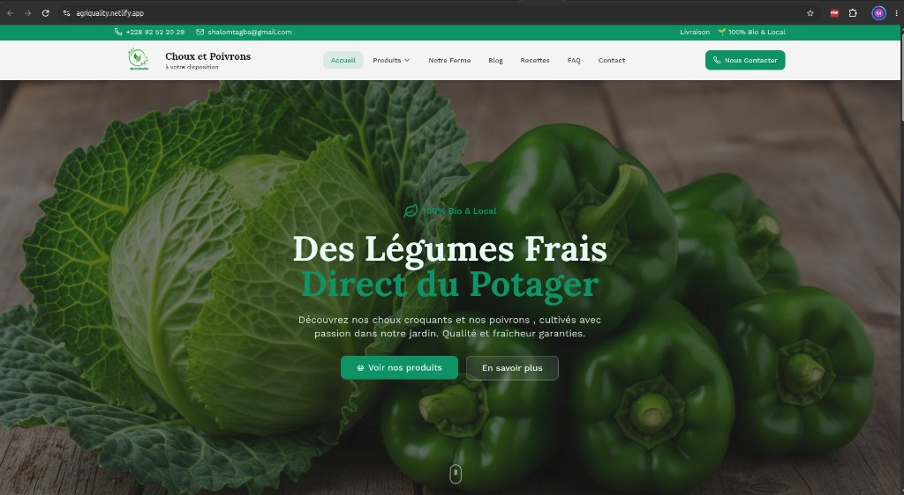
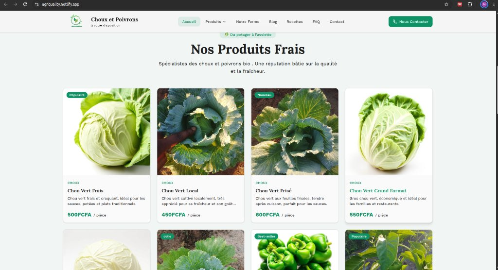
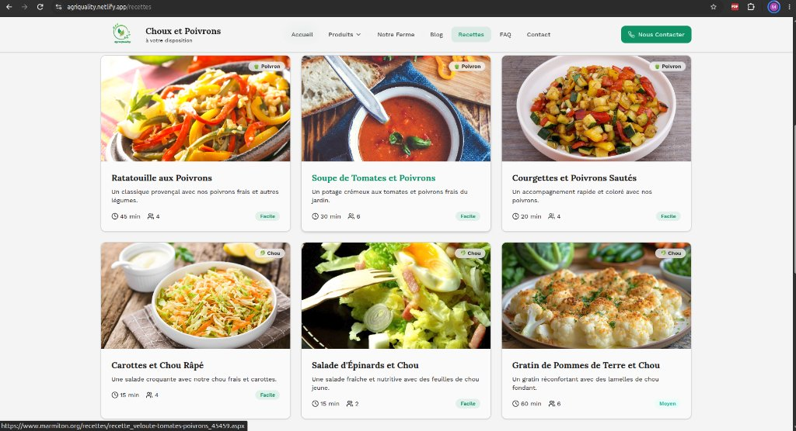
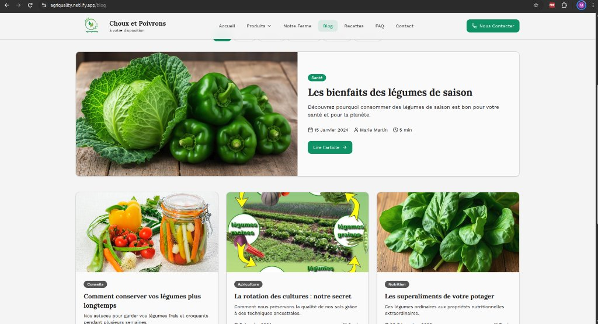
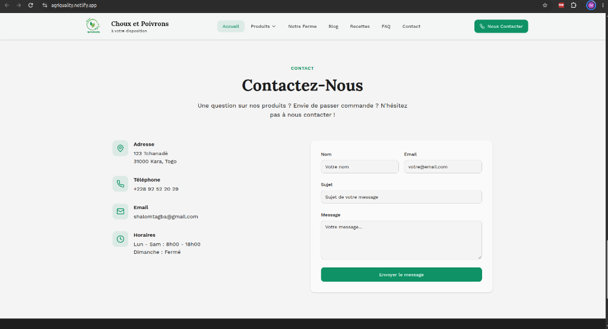

# Choux et Poivrons - Agriquality

Plateforme web vitrine et catalogue maraicher developpee pour valoriser et commercialiser des legumes frais, 100% bio et locaux, cultives durablement a Kara, Togo.

L'application met en relation directe les consommateurs, familles et restaurateurs avec la production maraichere locale, favorisant le circuit court, la transparence agricole et une alimentation saine.

- **Demonstration en ligne** : [https://agriquality.netlify.app](https://agriquality.netlify.app)
- **Localisation de la ferme** : Tchanade, Kara, Togo

---

## Apercu de la Plateforme

### 1. Page d'Accueil et En-tete Immersif
Presentation de la vision de la ferme biologique, mise en avant du concept "du potager a l'assiette" et acces rapide aux produits phares.



### 2. Catalogue des Produits Frais
Vitrine detaillee des varietes maraicheres disponibles (choux verts frais, choux locaux, choux frises, formats familiaux et poivrons verts) avec tarifs transparents en FCFA par piece.



### 3. Recettes et Conseils Culinaires
Section d'inspiration culinaire proposant des recettes equilibrees et accessibles (ratatouille aux poivrons, soupes, salades croquantes, gratins) pour encourager la consommation de legumes de saison.



### 4. Blog et Pedagogie Maraichere
Articles documentes sur les bienfaits nutritionnels, la rotation des cultures agricoles, la fertilite des sols et les astuces de conservation des recoltes.



### 5. Contact et Prise de Commande
Coordonnees completes de l'exploitation (adresse physique a Kara, telephone, email) et formulaire de contact direct pour les commandes et partenariats.



---

## Fonctionnalites Principales

### Experience Client et Navigation
- **Catalogue interactif de produits** : Fiches detaillees par legume avec descriptif gustatif, conseils d'utilisation et prix unitaire en FCFA.
- **Section Recettes avec filtres** : Fiches recettes illustrees indiquant le temps de preparation, le niveau de difficulte et le nombre de portions.
- **Espace Blog et Actualites** : Publications specialisees dans l'agriculture biologique et la sante par l'alimentation.
- **Presentation de la Ferme** : Histoire, methodes culturales agroecologiques et engagements qualite.
- **Foire Aux Questions (FAQ)** : Reponses aux questions frequentes sur les modalites de livraison, les labels bio et les commandes pour evenements.
- **Formulaire de contact securise** : Prise de contact validee par schema Zod et geree avec React Hook Form.

### Performance et Ergonomie
- **Design System moderne et responsive** : Interface soignee construite avec Tailwind CSS et Shadcn UI, garantissant une lisibilite ideale sur smartphones, tablettes et ordinateurs.
- **Navigation fluide** : Routage multi-pages sans rechargement pilote par React Router.
- **Architecture de composants modulaires** : Reutilisation efficace des cartes produits, badges de categorisation et composants de formulaires.

---

## Stack Technique

| Categorie | Technologies |
| :--- | :--- |
| **Framework & Langage** | React 18, TypeScript, Vite |
| **Design System & Styles** | Tailwind CSS, Shadcn UI, Radix UI Primitives, Lucide Icons |
| **Routage & Navigation** | React Router DOM |
| **Formulaires & Validation** | React Hook Form, Zod |
| **Gestion du Cache & Requetes** | TanStack React Query |
| **Deploiement & Hebergement** | Netlify |

---

## Installation et Lancement Local

### 1. Prerequis
- Node.js (version 18 ou superieure)
- npm, yarn ou bun

### 2. Cloner le depot
```bash
git clone https://github.com/maximedefaleouna/chou-poivron-emporium.git
cd chou-poivron-emporium
```

### 3. Installer les dependances
```bash
npm install
```

### 4. Demarrer le serveur de developpement
```bash
npm run dev
```
L'application sera accessible localement a l'adresse indiquee par Vite (generalement `http://localhost:5173`).

### 5. Generer la version de production
```bash
npm run build
```

---

## Auteur

**Maxime DEFALEOUNA**
- Profil GitHub : [@maximedefaleouna](https://github.com/maximedefaleouna)
